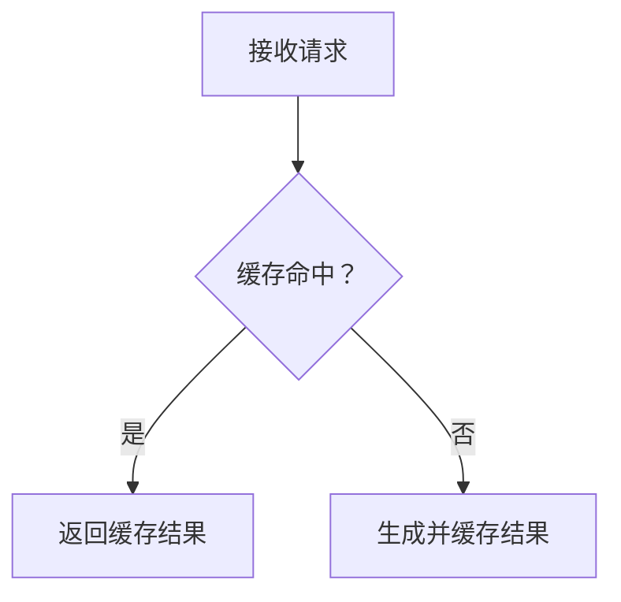

<!-- SPDX-License-Identifier: MIT -->

# GitHub 内容写作与 Markdown 排版规范

本规范适用于本仓库的 Issue、Pull Request、评论、README、Wiki 和技术文档。目标是让内容成为可检索、可审查、可验证的工程记录，而不是聊天记录。

## 核心原则

- **结论先行**：尽快说明问题、变更或需要作出的决定。
- **逻辑完整**：按背景、事实、分析、结论和行动组织信息。
- **排版自然**：段落、列表、代码块和表格各司其职。
- **证据充分**：重要判断由复现步骤、日志、代码位置、测试结果或数据支撑。
- **信息适量**：正文保留读者决策所需的信息，冗长辅助材料按需折叠。
- **渲染可读**：以 GitHub 页面上的最终效果为验收依据。

## 1. 按内容类型选择结构

| 内容类型 | 主要目标 | 推荐结构 |
| --- | --- | --- |
| Issue | 描述问题、需求或技术发现 | 摘要 → 实际现象 → 预期行为 → 复现步骤 → 证据 → 影响 |
| Pull Request | 解释修改及其合理性 | 变更摘要 → 修改原因 → 具体改动 → 验证结果 → 风险 |
| Comment | 回答问题或推动讨论 | 直接结论 → 关键依据 → 下一步行动 |
| README | 帮助用户了解并使用项目 | 项目介绍 → 功能 → 安装 → 配置 → 使用 → 故障排查 |
| Wiki / 技术长文 | 系统解释一个主题 | 背景 → 目标与范围 → 分析 → 方案对比 → 结论 → 参考资料 |

以上是推荐结构，不是必须填满的字段。简单问题保持简洁，复杂问题再增加章节。不要把同一份长篇分析原样复制到 Issue、PR 和评论中。

Issue 应明确区分已确认事实、合理推测和待验证假设。PR 应说明为什么改、改了什么、如何验证以及剩余风险。测试只有在真实执行并确认通过后才能标记为通过。评论聚焦当前问题，避免重复粘贴整篇 Issue。

## 2. 正确使用行内代码与代码块

### 行内代码

用于简短且需要精确识别的技术标识，例如变量、函数、类、配置键、环境变量、文件路径、短命令、接口和状态值：

> 当 `warm()` 执行完成后，`staticFreeModels` 仍然包含过期条目。

### 代码块

多行代码、JSON、YAML、配置、日志、终端输出和复现示例使用围栏代码块，并尽量注明语言：

```typescript
if (ctx.flags & F_WARM) {
  await refreshModelCatalog();
}
```

```json
{
  "model": "space-bunny-free",
  "status": "missing"
}
```

日志或终端输出使用 `text`。不要把多行内容塞进行内代码。

行内代码本身不会必然造成频繁换行。过长的不可断行文本、正文区域宽度、父级布局和 CSS 换行规则都可能影响显示。遇到异常折行，应同时检查内容和页面布局。

### 数学公式

能表达为公式的指标定义、损失函数、打分函数、相似度、更新规则和约束，优先使用 LaTeX，而不是伪代码式纯文本。

- 完整公式使用块级公式，`$$` 单独占行，公式前后各留一个空行。
- 句子中间的单个变量或符号可以使用行内公式，例如 $x$、$A^T$。
- 使用标准 LaTeX 记号表达分式、求和、矩阵、向量和下标。
- 不要把完整公式塞进行内代码，也不要用 `exp(-gamma * ||a_i - a_j||^2)` 代替公式。

标准写法：

```markdown
相似度按高斯核计算：

$$
s_{ij} = \exp\left(-\gamma \lVert \mathbf{a}_i - \mathbf{a}_j \rVert^2\right)
$$

其中 $\gamma$ 由全体数据的平均稀疏度确定。
```

## 3. 组织段落与标题

每个段落围绕一个中心观点展开。可以在同一段中先描述现象，再说明影响，最后给出证据；切换主题、论证阶段或操作步骤时再另起段落。

- 不要为模拟聊天而给每个短句单独建立段落。
- 不要把不同观点强行塞进同一段。
- 使用空行区分段落、列表、引用、表格和代码块。
- Markdown 源文本可以合理换行，最终页面由 GitHub 渲染和页面布局共同决定。
- Issue 和 PR 正文通常从 `##` 开始，因为页面标题已经承担主标题作用；README 通常使用 `#` 项目标题。
- `##` 用于主要章节，`###` 用于子主题；保持层级连续，不机械保留空章节。

短 Issue 可以不使用标题。长文应使用信息明确的标题，必要时提供目录、术语说明、交叉引用和参考资料。

如果文本在很窄的宽度内被迫折行，应检查正文实际可用宽度和 CSS，而不是只合并段落。尤其留意 Flex 布局收缩、`width`、`max-width`、`word-break`、`overflow-wrap` 和 `white-space`。

## 4. 列表与表格

### 列表

- 操作流程按执行顺序使用有序列表。
- 独立事实、特征和影响使用无序列表。
- 任务跟踪使用 `- [ ]` 和 `- [x]`。
- 相关列表项保持紧凑；列表项包含多个段落、代码块或子列表时，保留必要空行和缩进。
- 不要把连贯论述拆成大量只有几个字的列表项。

### 表格

表格适合版本对比、测试矩阵、配置差异和结果汇总。每列应有明确含义，每行应代表一个可比较的项目。

```markdown
| Version | Model picker | Bootstrap behavior |
| --- | --- | --- |
| 0.3.10 | Model visible | Normal |
| 0.3.11 | Model missing | Stale catalog |
```

大段分析、长日志和复杂代码不要塞进表格单元格。内容过长时，将完整证据放在表格之外，通过链接或相邻章节引用。考虑手机端和窄屏的可读性，限制列数和单元格长度。

## 5. 折叠块与引用

仅将不需要所有读者立即查看的辅助信息放入 `<details>`，例如完整日志、已在正文总结过的测试输出、可选环境信息和补充实验。

```html
<details>
<summary>查看完整诊断日志</summary>

```text
Request started: 10:30:00
Request timed out: 10:30:04
Catalog entries returned: 0
```

</details>
```

正文必须先呈现结论、关键错误和必要上下文。不要把根因、核心复现步骤、关键测试结论或待评审决定藏进折叠块。

使用 `>` 引用外部评论、文档原文或需要回应的具体观点，并区分引用和自己的分析。保留足够上下文，避免截断造成误解。

## 6. 链接、图片与 Mermaid

- 优先链接到具体 Issue、PR、代码行、文档章节或提交，而不只是仓库首页。
- 链接文字应说明目标内容，例如用 `[实现位置](relative/path/to/file)` 指向实际存在的文件。
- 图片和截图用于展示视觉问题、UI 差异或测试结果；图片前说明希望读者观察什么，必要时对比预期与实际表现。
- 流程、依赖关系、状态转换和复杂交互适合使用 Mermaid；简单线性步骤通常使用编号列表。



图表解释正文中的核心逻辑，节点文字保持简洁。图表不能替代关键假设、异常条件或验证证据。

## 7. 分离事实、假设、方案和验证

技术分析应让其他开发者能够验证判断。推荐明确区分：

- **Observed behavior**：实际观察到的结果，注明版本、环境和触发条件。
- **Evidence**：日志、代码位置、测试数据或可复现步骤。
- **Root cause**：由证据支持的因果关系；未确认时标为待验证假设。
- **Proposed fix**：解决方案、预期行为和主要权衡。
- **Verification**：实际执行的测试、检查结果和未覆盖场景。

不要混淆已复现问题与推测问题、相关性与根因、建议方案与已实施改动、计划执行的测试与实际通过的测试。

## 8. 常用模板

### Issue

```markdown
## Summary

一句话说明问题及其主要影响。

## Actual behavior

描述实际现象，并提供最关键的证据。

## Expected behavior

描述正确行为以及可验证的成功标准。

## Steps to reproduce

1. ...
2. ...
3. ...

## Environment

- Version:
- Platform:
- Configuration:

## Root cause

说明已确认的根因，或列出仍待验证的假设。

## Proposed fix

提出解决方向、约束和预期效果。
```

### Pull Request

```markdown
## Summary

概述本次变更及其目的。

## Changes

- ...
- ...

## Related issues

Fixes #123

## Testing

- [x] 已实际执行并通过的测试
- [ ] 尚未执行的测试

## Risks and compatibility

说明兼容性影响、迁移要求或剩余风险。
```

### Comment

直接回答当前问题，再提供关键代码位置、日志、测试结果或相关链接，最后指出需要修改的内容、待验证假设或需要作出的决定。简单评论只保留结论即可。

## 9. 发布前检查最终渲染

提交前检查 GitHub 渲染后的页面，尤其是包含大量代码、表格、嵌套列表和图片的长文：

- 标题层级清晰，关键结论容易定位。
- 段落连贯，没有大量碎片化短段落。
- 正文没有异常狭窄的可用宽度或不合理折行。
- 列表、代码块、表格和引用正确渲染。
- 长日志放在适当的折叠块中。
- 表格不过宽，链接、Issue 编号、图片和 Mermaid 有效。
- 环境、复现步骤、证据、结论和测试状态准确。

异常换行要区分内容问题与布局问题。内容问题包括段落过碎、句子组织不合理、长标识符过多和表格设计不佳；布局问题包括容器过窄、Flex 收缩、宽度约束和 CSS 换行规则。布局问题应先检查实际宽度和 CSS。

## 最终执行标准

高质量 GitHub 内容应同时满足：内容完整、结构合理、排版自然、证据可查、渲染正常、状态真实。

**最终原则：先保证内容准确、结构清晰、逻辑完整，再优化视觉表现；以 GitHub 上的实际渲染结果作为排版验收标准。**
