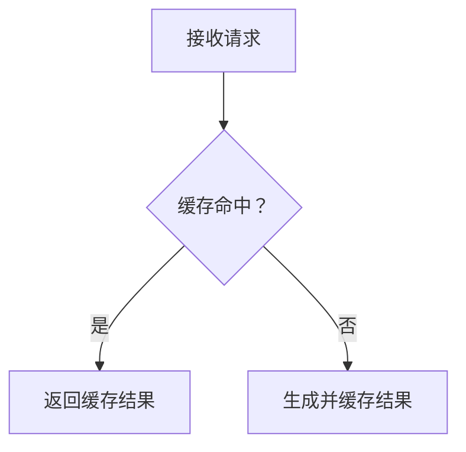

<!--
Copyright (C) 2026 kaoyan-english-grader contributors
SPDX-License-Identifier: GPL-3.0-or-later
This file is licensed under GPL-3.0-or-later. See LICENSE.
-->

# GitHub 内容写作与 Markdown 排版规范

本规范约束本仓库在 GitHub 上发布的 Issue、Pull Request、评论、README、Wiki 与技术分析。将其视为结构化工程文档，而不是聊天记录。

**验收标准：读者能够快速定位信息、准确理解上下文、核查重要判断，并明确下一步行动。**

## 核心原则

- **结论先行：** 先说明问题、变更或需要作出的决定。
- **逻辑完整：** 按背景、事实、分析、结论和行动组织信息。
- **排版自然：** 段落、列表、表格和代码块各司其职。
- **证据充分：** 用复现步骤、日志、代码位置、测试结果或数据支撑判断。
- **信息适量：** 正文保留决策所需信息，冗长辅助材料按需折叠。
- **渲染可读：** 以 GitHub 页面最终效果为准。

## 1. 按内容类型组织结构

| 内容 | 主要目标 | 推荐结构 |
| --- | --- | --- |
| Issue | 描述问题、需求或技术发现 | 摘要 → 实际现象 → 预期行为 → 复现 → 证据 → 影响 → 建议 |
| Pull Request | 说明修改及合理性 | 变更摘要 → 原因 → 具体改动 → 验证 → 风险 |
| Comment | 回答问题并推动讨论 | 直接结论 → 关键依据 → 下一步 |
| README | 帮助用户理解和使用项目 | 介绍 → 功能 → 安装 → 配置 → 使用 → 排障 |
| Wiki / 技术长文 | 系统解释主题 | 背景 → 范围 → 分析 → 方案比较 → 结论 → 资料 |

这是推荐结构，不是必填字段。简单修复保持简洁；复杂问题再增加章节。不要将同一份长篇分析原样复制到 Issue、PR 和评论。

Issue 应区分事实、推测和待验证假设。PR 应说明为什么改、改了什么、如何验证及剩余风险。评论聚焦当前问题，不重复整篇 Issue。README 和 Wiki 面向首次阅读与后续检索，使用稳定标题和交叉链接。

## 2. 行内代码、代码块与数学公式

### 行内代码

用行内代码标记需要精确识别的变量、函数、类、参数、配置键、环境变量、路径、短命令、接口和状态值，例如 `staticFreeModels`、`warm()`、`FREE_LANE_BLOCKLIST`、`GET /healthz`。

### 代码块

多行代码、JSON、YAML、配置、日志、终端输出和复现示例使用围栏代码块，并添加语言标识。

```typescript
if (ctx.flags & F_WARM) {
  await refreshModelCatalog();
}
```

```json
{
  "model": "space-bunny-free",
  "status": "missing"
}
```

日志使用 `text`。过长的不可断行字符串、正文宽度、父级布局和 CSS 换行规则都会影响折行；异常换行应同时检查内容和页面布局。

### 数学公式

指标、损失函数、打分函数、相似度、更新规则和约束优先使用 LaTeX，不用纯文本伪公式。

- 完整公式使用块级公式，`$$` 单独占行，公式前后各留一个空行。
- 只有句中单个变量或符号使用行内公式，如 $x$、$A^T$、$\lambda_1$。
- 使用标准 LaTeX 表达分式、求和、矩阵、向量和下标。
- 不要把长公式放进行内代码，或写成 `exp(-gamma * ||a_i - a_j||^2)`。

示例：

```markdown
相似度按高斯核计算：

$$
s_{ij} = \exp\left(-\gamma \lVert \mathbf{a}_i - \mathbf{a}_j \rVert^2\right)
$$

其中 $\gamma$ 由全体数据的平均稀疏度确定。
```

## 3. 段落与标题

每段围绕一个中心观点。可以把现象、影响和证据放在同一段；主题、论证阶段或操作发生变化时另起一段。

- 不要将每个短句单独成段，也不要把无关观点塞进同一段。
- 用空行分隔段落、列表、引用、表格和代码块。
- Markdown 源文本可按合理长度换行，最终效果由 GitHub 渲染和页面布局共同决定。
- Issue/PR 正文通常从 `##` 开始；README 使用 `#` 项目标题。
- `##` 用于主要章节，`###` 用于子主题；层级连续，不保留空章节。

短 Issue 可以不设标题。长文使用有信息量的标题，必要时提供目录、术语和交叉引用。异常折行时检查容器宽度、Flex 收缩、`width`、`max-width`、`word-break`、`overflow-wrap` 和 `white-space`。

## 4. 列表与表格

操作步骤使用有序列表；独立事实和特征使用无序列表；任务跟踪使用 `- [ ]` 和 `- [x]`。列表项保持紧凑，只有在包含多个段落、代码块或子列表时才增加空行和缩进。连续论证使用段落，不要拆成短碎片。

表格适合版本比较、测试矩阵、配置差异和结果汇总。每列含义明确，每行代表可比较对象。长分析、日志和代码放在表格之外。控制列数和单元格长度，并考虑窄屏阅读。

## 5. 折叠块与引用

仅将辅助信息放入 `<details>`，例如完整日志、已总结的测试输出、可选环境和补充实验。正文先呈现结论、关键错误和必要上下文；不要隐藏根因、复现步骤、关键测试结论或评审决定。

使用 `>` 引用需要回应的原文或观点，保留必要上下文，并明确区分引用和自己的分析。

## 6. 链接、图片与 Mermaid

优先链接到具体 Issue、PR、代码行、文档章节或提交。使用描述性链接文字。截图前说明观察重点，必要时对比预期和实际结果。

流程、依赖、状态转换和复杂交互适合 Mermaid；简单线性步骤使用编号列表。



图表解释正文逻辑，不替代假设、异常条件和验证证据。

## 7. 分离事实、假设、方案与验证

技术分析应分别呈现：

- **Observed behavior：** 实际现象、版本、环境和触发条件。
- **Evidence：** 日志、代码位置、测试数据或复现步骤。
- **Root cause：** 有证据支持的因果关系；未确认时标记为假设。
- **Proposed fix：** 解决方案、预期行为和权衡。
- **Verification：** 实际执行的测试、结果和未覆盖场景。

不要混淆复现问题与猜测、相关性与根因、建议方案与已实施改动、计划测试与实际通过。

## 8. 常用模板

### Issue

```markdown
## Summary
说明问题及主要影响。

## Actual behavior
描述现象并提供关键证据。

## Expected behavior
说明预期结果和成功标准。

## Steps to reproduce
1. ...
2. ...

## Environment
- Version:
- Platform:

## Root cause
说明已确认原因，或标记待验证假设。

## Proposed fix
说明方案、约束和预期结果。

## Verification
列出验证方式与实际结果。
```

### Pull Request

```markdown
## Summary
说明变更及目的。

## Changes
- ...
- ...

## Related issues
Fixes #123

## Testing
- [x] 已执行并通过
- [ ] 尚未执行

## Risks and compatibility
说明兼容性、迁移要求和剩余风险。
```

Comment 直接回答当前问题，再给必要依据和下一步。README/Wiki 根据项目实际情况选择 Features、Architecture、Requirements、Installation、Configuration、Usage、Troubleshooting、Development、Contributing 和 License 等章节。

## 9. 发布前检查最终渲染

检查标题层级、段落连贯性、可用宽度、列表/代码/表格/引用渲染、折叠日志、链接和 Mermaid。核对环境、复现、证据、结论和测试状态。

异常折行应区分内容问题与布局问题。内容问题包括段落碎片化、句子组织不当、长标识符和宽表格；布局问题包括容器过窄、Flex 收缩、宽度约束和 CSS 换行。布局问题先检查实际宽度和 CSS，再决定是否修改文案。

## 最终标准

内容完整、结构合理、排版自然、证据可查、渲染正常、状态真实。

**先保证准确、清晰和逻辑完整，再优化视觉表现；以 GitHub 实际渲染结果作为排版验收标准。**
