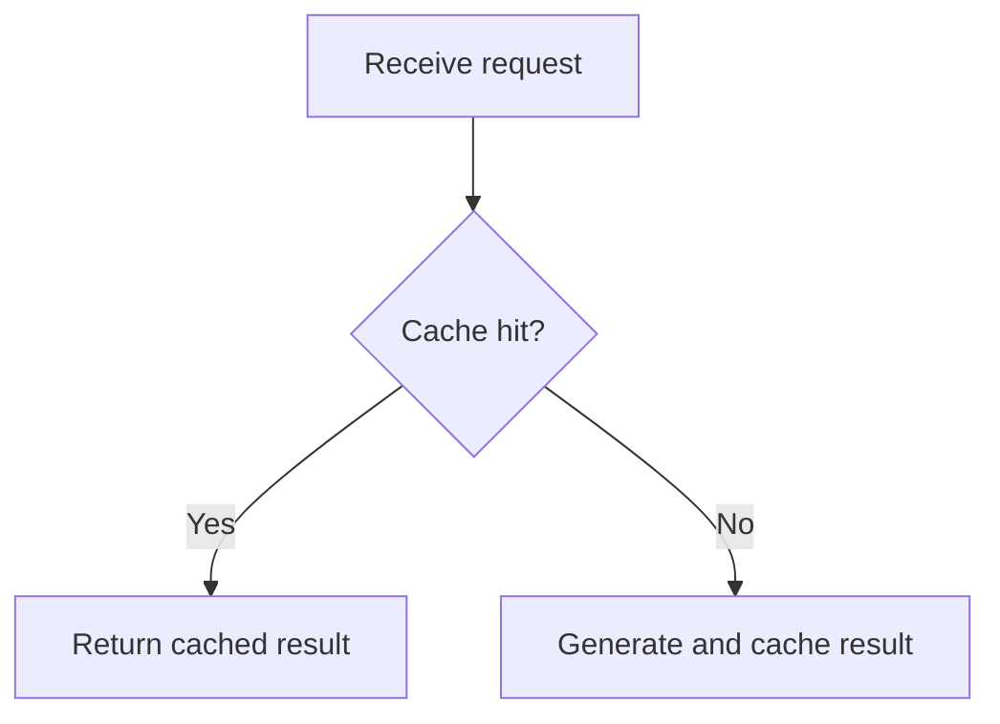

<!--
Copyright (C) 2026 kaoyan-english-grader contributors
SPDX-License-Identifier: GPL-3.0-or-later
This file is licensed under GPL-3.0-or-later. See ../../LICENSE.
-->

# GitHub 内容写作与 Markdown 排版规范

本规范管理 GitHub 内容的结构、Markdown 表达、证据呈现和最终渲染。公开开源文档的范围、信息架构、语言决策和发布门禁见 [open-source-docs.md](open-source-docs.md)；本机与私有文档见 [local-dev-docs.md](local-dev-docs.md)。

## 核心原则

在 GitHub 上撰写 Issue、Pull Request、评论、README、Wiki 和技术分析时，将内容视为**结构化技术文档**，而不是聊天记录。内容应结论先行、逻辑完整、排版自然、证据充分、信息适量，并以 GitHub 页面上的实际渲染效果作为验收标准。

## 1. 根据内容目标选择结构

| 内容类型 | 主要目标 | 推荐结构 |
| --- | --- | --- |
| Issue | 描述问题、需求或技术发现 | 摘要 → 实际现象 → 预期行为 → 复现步骤 → 证据 → 影响 → 建议 |
| Pull Request | 解释变更及其合理性 | 变更摘要 → 修改原因 → 具体改动 → 验证结果 → 风险 |
| Comment | 回答问题、提供证据或推动讨论 | 直接结论 → 关键依据 → 下一步行动 |
| README | 介绍项目并帮助用户开始使用 | 项目定位 → 功能 → 安装 → 配置 → 使用 → 排查 |
| Wiki / 技术长文 | 系统解释主题 | 背景 → 目标与范围 → 分析 → 方案比较 → 结论 → 参考资料 |

这些结构是推荐顺序，不是强制字段。简单修复使用简短描述；复杂问题再增加章节。Issue 优先说明现象、复现、预期和证据；PR 说明原因、改动、实际验证和风险；评论聚焦当前问题；长文使用稳定标题和交叉引用。

## 2. 行内代码、代码块与数学公式

行内代码用于变量、函数、类、参数、配置键、环境变量、文件路径、短命令、接口和状态值等短标识。例如：`warm()` 执行完成后，`staticFreeModels` 仍然包含过期条目。

多行代码、JSON、YAML、配置、日志、终端输出和复现示例使用代码块。优先指定语言；日志和终端输出使用 `text`。

```typescript
if (ctx.flags & F_WARM) {
  await refreshModelCatalog();
}
```

```json
{
  "model": "space-bunny-free",
  "status": "missing"
}
```

行内代码本身不会必然造成频繁换行。过长的不可断行文本可能影响布局；容器宽度、父级 Flex 收缩和 CSS 换行规则也会产生类似现象。排查时同时检查文案和页面布局。

可用数学公式表达的指标定义、损失函数、打分函数、相似度、更新规则和约束，使用 LaTeX，而不是伪代码式文本。块级公式优先使用 `$$`，两个定界符分别单独占一行，公式前后留空行；句子中的单个变量可以使用 `$...$`。分式、求和、矩阵、向量和下标使用标准 LaTeX 记号。

```markdown
相似度按高斯核计算：

$$
s_{ij} = \exp\left(-\gamma \lVert \mathbf{a}_i - \mathbf{a}_j \rVert^2\right)
$$

其中 $\gamma$ 由全体数据的平均稀疏度确定。
```

## 3. 组织段落，避免碎片化

每段围绕一个中心观点展开。相关现象、影响和证据可以放在同一段；切换主题、论证阶段或操作步骤时再另起段落。

- 不为模拟聊天消息而把每个短句单独拆段。
- 不把无关观点强行塞进同一段。
- 不机械限制每段句子数量，按逻辑完整性和阅读难度组织。
- Markdown 源文本可以合理换行，最终显示由 GitHub 渲染和页面布局共同决定。
- 用空行区分段落、列表、引用、表格和代码块。

频繁换行需要区分内容问题和布局问题。页面可用宽度过窄时，应检查容器和 CSS，不要只通过重写文案掩盖布局缺陷。

## 4. 标题层级

Issue 和 PR 标题已经承担页面主标题作用，正文通常从 `##` 开始。README 通常需要自己的 `#` 标题。

```markdown
## Summary

## Problem

## Reproduction

## Root cause

## Proposed fix

## Verification
```

`##` 用于主要章节，`###` 用于子主题。标题准确概括后续内容，保持层级连续；不为视觉效果频繁切换级别。短 Issue 可以不设标题，长文应使用标题导航。

## 5. 列表与段落

独立步骤、条件和要点使用列表；因果关系、方案权衡和完整论证使用自然段落。操作流程使用有序列表，独立事实使用无序列表，任务跟踪使用 `- [ ]` 和 `- [x]`。相关列表项保持紧凑；包含多段文字、代码块或子列表时保留必要空行和缩进。

## 6. 表格

表格适合版本比较、测试矩阵、配置差异和结果汇总等具有共同字段的数据。

```markdown
| Version | Model picker | Bootstrap behavior |
| --- | --- | --- |
| 0.3.10 | Model visible | Normal |
| 0.3.11 | Model missing | Stale catalog |
```

每列含义明确，每行代表可比较项目。大段分析、长日志和复杂代码放在表格之外；手机端和窄屏应限制列数及单元格长度。

## 7. 折叠块

只将不需要所有读者立即查看的辅助信息放进 `<details>`，例如完整日志、已在正文总结过的测试输出、可选环境信息和补充实验。

```html
<details>
<summary>Show full diagnostic logs</summary>

```text
Request started: 10:30:00
Request timed out: 10:30:04
Catalog entries returned: 0
```

</details>
```

正文先展示结论、关键错误和上下文，再折叠完整证据。不要隐藏根因、核心复现步骤、关键测试结论或待决事项。

## 8. 引用、链接、图片与 Mermaid

使用 `>` 引用外部评论、文档原文或需要回应的观点，并区分引用和自己的分析。链接优先指向具体 Issue、PR、代码行、文档章节或提交，使用有意义的文字。

```markdown
See [the repository README](../../README.md).
```

图片前说明希望读者观察什么，必要时对比预期和实际表现。流程、依赖关系、状态转换和复杂交互适合 Mermaid；简单线性步骤使用编号列表更轻便。



图表应解释正文逻辑，不能替代关键假设、异常条件或验证证据。

## 9. 事实、假设、方案和验证

技术分析应让其他开发者可以复核判断：

- **Observed behavior：** 实际结果、版本、环境和触发条件。
- **Evidence：** 日志、代码位置、测试数据或复现步骤。
- **Root cause：** 有证据支持的因果关系；未确认时标记为待验证假设。
- **Proposed fix：** 解决方案、预期行为和主要权衡。
- **Verification：** 实际执行的测试、检查结果和未覆盖场景。

不要混淆已复现与推测、相关性与根因、建议方案与已实施改动、计划测试与实际通过测试。

## 10. 内容模板

### Issue

```markdown
## Summary
说明问题及主要影响。

## Actual behavior
描述现象并提供关键证据。

## Expected behavior
说明正确行为和成功标准。

## Steps to reproduce
1. ...
2. ...

## Environment
- Version:
- Platform:
- Configuration:

## Root cause
说明已确认原因，或标记待验证假设。

## Proposed fix
说明解决方向与约束。

## Verification
说明验证方式和真实结果。
```

### Pull Request

```markdown
## Summary
概述本次变更及其目的。

## Changes
- ...
- ...

## Related issues
Fixes #123

## Testing
- [x] 已实际执行并通过的测试
- [ ] 尚未执行的测试

## Risks and compatibility
说明兼容性影响和剩余风险。
```

### Comment

```markdown
结论：直接回答当前讨论的问题。

依据：提供关键代码位置、日志、测试结果或链接。

下一步：指出需要修改的内容、待验证假设或需要作出的决定。
```

### README / Wiki

```markdown
# Project Name

一句话说明项目用途与主要价值。

## Features

## Architecture

## Requirements

## Installation

## Configuration

## Usage

## Troubleshooting

## Development

## Contributing

## License
```

按项目实际情况增删章节。README 解决用户理解、安装和使用问题；深入设计和历史决策放入专题文档。

## 11. 发布前检查渲染结果

- [ ] 标题层级清楚，关键结论容易定位。
- [ ] 段落连贯，没有大量碎片化短段。
- [ ] 正文宽度合理，没有异常折行。
- [ ] 列表、代码块、表格和引用正确渲染。
- [ ] 长日志放在合适的折叠块中。
- [ ] 表格宽度和代码块滚动体验合理。
- [ ] 链接、Issue 编号、图片和 Mermaid 有效。
- [ ] 环境、复现步骤、证据、结论和测试状态准确。

异常换行分开检查内容和布局。布局检查包括容器宽度、父级 Flex 收缩、`width` / `max-width`，以及 `word-break`、`overflow-wrap`、`white-space` 等样式。

## 最终执行标准

高质量 GitHub 内容应内容完整、结构合理、排版自然、证据可查、渲染正常、状态真实。**先保证事实准确、结构清晰、逻辑完整，再优化视觉表现；以 GitHub 实际渲染结果作为排版验收标准。**
