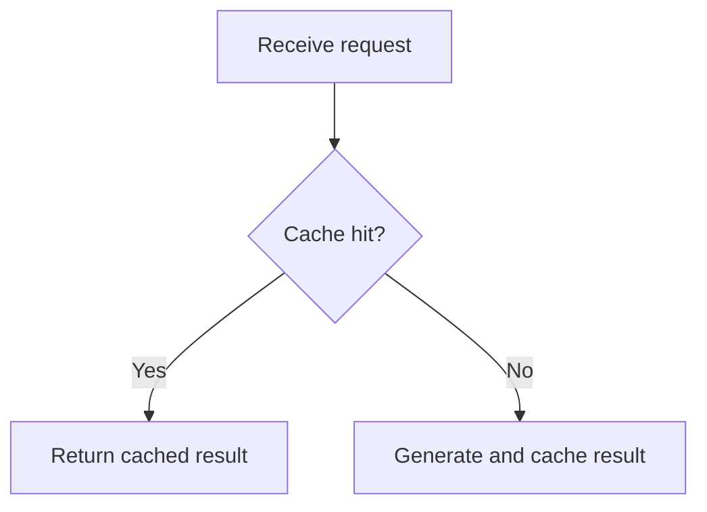

<!--
Copyright (C) 2026 kaoyan-english-grader contributors
SPDX-License-Identifier: GPL-3.0-or-later
This file is licensed under GPL-3.0-or-later. See LICENSE.
-->

# GitHub 内容写作与 Markdown 排版规范

本规范负责 GitHub 内容的结构、Markdown 表达、证据呈现和最终渲染。公开开源文档的范围、文档体系、语言决策与发布门禁见 [open-source-docs.md](open-source-docs.md)；本机、私有项目和开发环境文档见 [local-dev-docs.md](local-dev-docs.md)。

## 核心原则

把 Issue、Pull Request、评论、README、Wiki 和技术分析视为**结构化技术文档**，而不是聊天记录。

高质量内容应当做到：

- **结论先行：** 读者尽快理解问题、变更或需要作出的决定。
- **逻辑完整：** 按照背景、事实、分析、结论和行动组织信息。
- **排版自然：** 段落、列表、代码块和表格承担合适的表达任务。
- **证据充分：** 用可复现步骤、日志、代码位置、测试结果和数据支撑判断。
- **信息适量：** 正文展示必要信息，详细日志、辅助证据和补充分析按需展开。
- **渲染可读：** 以 GitHub 页面最终显示效果为准，不以 Markdown 源文本外观代替验收。

核心标准是：**读者能够快速定位信息、准确理解上下文，并明确下一步应该做什么。**

## 1. 先选择适合的内容结构

不同内容有不同目标，不要将同一份长篇分析原样复制到所有位置。

| 内容类型 | 主要目标 | 推荐结构 |
| --- | --- | --- |
| Issue | 描述问题、需求或技术发现 | 摘要 → 实际现象 → 预期行为 → 复现步骤 → 证据 → 影响 → 建议 |
| Pull Request | 解释修改内容及其合理性 | 变更摘要 → 修改原因 → 具体改动 → 验证结果 → 风险 |
| Comment | 回答问题、提供证据或推动讨论 | 直接结论 → 关键依据 → 下一步行动 |
| README | 让用户快速了解并使用项目 | 项目介绍 → 功能 → 安装 → 配置 → 使用 → 故障排查 |
| Wiki / 技术长文 | 系统解释一个主题 | 背景 → 目标与范围 → 分析 → 方案对比 → 结论 → 参考资料 |

这是一组推荐结构，不是必须填满的字段。简单修复使用简短描述即可；复杂问题再增加章节。

### Issue：描述清楚问题

优先回答四个问题：发生了什么、怎样复现、预期应该怎样、现有证据说明了什么。

把已确认事实、合理推测和待验证假设分别标明。根因尚未确认时，可以提出可能原因，但必须说明验证状态。

### Pull Request：说明修改及验证

重点说明为什么改、改了什么、如何证明修改有效，以及可能存在的风险。关联 Issue 可以使用 `Fixes #123`、`Closes #123` 等引用。测试结果必须来自实际执行记录，不能把计划执行的测试写成已经通过。

### Comment：让每条回复聚焦一个目标

先直接回答当前问题，再补充必要的证据、代码位置或行动建议。多个相互独立的问题应分别组织，避免在一个超长评论里混合问题、补丁、历史背景和无关建议。

### README / Wiki / 技术长文：面向后续检索

长文应采用稳定的标题体系，必要时加入目录、术语说明、交叉引用和参考资料。内容范围与语言决策遵循 [开源文档规范](open-source-docs.md)。

## 2. 正确使用行内代码与代码块

### 行内代码：标记简短技术标识

适用于变量、函数、类、参数名、配置键、环境变量、文件路径、短命令、接口和状态值。

例如：当 `warm()` 执行完成后，`staticFreeModels` 仍然包含过期条目。

### 代码块：承载需要整体阅读的内容

多行代码、JSON、YAML、配置文件、日志、终端输出和复现示例使用代码块。始终优先使用带语言标识的围栏代码块。

```typescript
if (ctx.flags & F_WARM) {
  await refreshModelCatalog();
}
```

```json
{
  "model": "space-bunny-free",
  "status": "missing"
}
```

日志或终端输出没有合适的语法类型时，使用 `text`。

**重要区别：** 行内代码不会必然造成频繁换行。过长的不可断行文本可能影响布局；正文区域宽度过窄、父级布局约束和 CSS 文本换行规则也可能造成类似现象。遇到异常换行，应同时检查内容和页面布局。

### 数学公式：优先使用块级 LaTeX

指标定义、损失函数、打分函数、相似度、更新规则和约束等数学内容，使用 LaTeX 公式表达，替代纯文字或伪代码式公式。

- 块级公式尽量使用 `$$`，且两个 `$$` 分别单独占一行。
- 块级公式前后各留一个空行。
- 句子中间单个变量或符号可以使用 `$...$`。
- 一个式子需要完整阅读或推导时，使用块级公式。
- 分式使用 `\frac`，求和使用 `\sum`，矩阵与向量使用 `\mathbf`，下标使用 `_`。

标准写法：

```markdown
相似度按高斯核计算：

$$
s_{ij} = \exp\left(-\gamma \lVert \mathbf{a}_i - \mathbf{a}_j \rVert^2\right)
$$

其中 $\gamma$ 由全体数据的平均稀疏度确定。
```

避免把公式写成 `exp(-gamma * ||a_i - a_j||^2)`，也不要把长公式塞进行内代码。

## 3. 组织段落，避免碎片化

每个段落围绕一个中心观点展开。相互关联的现象、影响和证据可以放在同一段；切换主题、论证阶段或操作步骤时再另起段落。

段落规则：

- 不要为了模拟聊天消息而给每个短句单独建立一个段落。
- 不要把不同观点强行塞进同一段。
- 不机械限制每段句子数量，以逻辑完整性和阅读难度判断。
- Markdown 源文本可以按合理长度换行，最终显示由 GitHub Markdown 渲染和页面布局共同决定。
- 用空行明确区分段落、列表、引用、表格和代码块。

**不要将频繁换行全部归因于文案。** 如果文本在很短的宽度内就被迫折行，应检查页面实际可用宽度和相关 CSS，而不是仅仅合并段落。

## 4. 使用标题建立清晰的信息层级

Issue 和 PR 标题已经承担页面主标题的作用，正文一般从 `##` 开始。

```markdown
## Summary

## Problem

## Reproduction

## Root cause

## Proposed fix

## Verification
```

标题规范：

- `##` 用于主要章节，`###` 用于章节内子主题。
- 标题准确概括后续内容，避免没有信息量的标题。
- 根据实际内容选择章节，无须机械保留空章节。
- 保持层级连续，不为视觉效果频繁切换级别。
- 简短 Issue 可以不使用标题；长文应使用标题导航。
- README 通常需要自己的 `#` 项目标题。

## 5. 列表用于离散事项，段落用于连续论证

独立步骤、条件或要点使用列表；因果关系、方案权衡和完整论证使用自然段落。

```markdown
## Reproduction

1. Start the application with the default configuration.
2. Wait for the remote model request to exceed the timeout.
3. Open the model picker.
4. Observe that the expected model is missing.
```

列表规范：

- 操作流程按执行顺序使用有序列表。
- 独立事实、特征和影响使用无序列表。
- 任务跟踪使用 `- [ ]` 和 `- [x]`。
- 相关列表项保持紧凑，简单项目之间不必插入空行。
- 列表项包含多个段落、代码块或子列表时，保留必要的空行和缩进。
- 不要把连贯论述拆成大量短小列表项。

## 6. 表格用于对比，不用于容纳所有内容

表格适合版本对比、测试矩阵、配置差异和结果汇总等具有共同字段的数据。

```markdown
| Version | Model picker | Bootstrap behavior |
| --- | --- | --- |
| 0.3.10 | Model visible | Normal |
| 0.3.11 | Model missing | Stale catalog |
```

每列含义明确，每行代表可比较项目。大段分析、长日志和复杂代码放在表格之外。手机端或窄屏可能无法完整显示宽表格，应限制列数和单元格长度。

表格不是越多越专业。两个简单要点可直接使用列表；多个属性需要逐项比较时，表格更清晰。

## 7. 用折叠块管理辅助信息

只将不需要所有读者立即查看的次要信息放入 `<details>`，例如大量日志、已在正文总结过的完整测试输出、可选环境信息和补充实验。

```html
<details>
<summary>Show full diagnostic logs</summary>

```text
Request started: 10:30:00
Request timed out: 10:30:04
Catalog entries returned: 0
```

</details>
```

正文先展示结论、关键错误和必要上下文，再折叠完整证据。不要隐藏根因、核心复现步骤、关键测试结论或需要评审者决定的事项。

## 8. 正确处理引用、链接、图片和 Mermaid

### 引用块

使用 `>` 引用外部评论、文档原文或需要回应的观点。保留必要上下文，明确区分引用与自己的分析，避免截断造成误解。

### 链接

优先链接到具体 Issue、PR、代码行、文档章节或提交，而不是只链接整个仓库。使用有意义的链接文字。

```markdown
See [the catalog filtering implementation](../src/catalog.ts).
```

仓库内链接的相对路径应与项目结构一致；关键外部证据使用有效的目标 URL。

### 图片与截图

图片用于展示视觉问题、UI 差异或测试结果。图片前应说明希望读者观察什么，必要时对比预期与实际表现。

### Mermaid

流程、依赖关系、状态转换和复杂交互适合使用 Mermaid；简单线性步骤优先使用编号列表。



图表解释正文中的核心逻辑，节点文字保持简洁。图表不能替代关键假设、异常条件或验证证据。

## 9. 分离事实、假设、方案和验证

技术分析应让其他开发者能够验证判断。推荐按以下顺序组织：

- **Observed behavior：** 实际结果、版本、环境和触发条件。
- **Evidence：** 日志、代码位置、测试数据或可复现步骤。
- **Root cause：** 有证据支持的因果关系；未确认时标记为待验证假设。
- **Proposed fix：** 解决方案、预期行为和主要权衡。
- **Verification：** 实际执行的测试、检查结果和未覆盖场景。

不要混淆已复现与推测、相关性与根因、建议与已实施改动、计划测试与实际通过测试。

## 10. 针对不同内容使用不同模板

### Issue

```markdown
## Summary
说明问题及主要影响。

## Actual behavior
描述现象并提供关键证据。

## Expected behavior
说明预期结果和成功标准。

## Steps to reproduce
1. ...
2. ...
3. ...

## Environment
- Version:
- Platform:
- Configuration:

## Root cause
说明已确认原因，或标记待验证假设。

## Proposed fix
说明解决方向、约束和预期效果。

## Verification
说明验证方式和实际结果。
```

### Pull Request

```markdown
## Summary
说明变更及目的。

## Changes
- ...
- ...

## Related issues
Fixes #123

## Testing
- [x] 已实际执行并通过
- [ ] 尚未执行

## Risks and compatibility
说明兼容性、迁移要求和剩余风险。
```

### Comment

直接回答当前问题，再给必要依据和下一步行动。简单评论只保留结论；涉及多个独立问题时分段或分条回复。

### README / Wiki

根据项目实际情况选择 Features、Architecture、Requirements、Installation、Configuration、Usage、Troubleshooting、Development、Contributing 和 License 等章节。具体文档范围和 README 语言遵循 [open-source-docs.md](open-source-docs.md)。

## 11. 发布前检查最终渲染

提交前检查 GitHub 渲染后的正文，尤其是包含大量代码、表格、嵌套列表和图片的长文：

- 标题层级清晰，关键结论容易定位。
- 段落连贯，没有大量碎片化短段落。
- 正文没有异常狭窄的可用宽度或不合理折行。
- 列表、代码块、表格和引用正确渲染。
- 长日志放在适当的折叠块中。
- 表格不过宽，链接、Issue 编号、图片和 Mermaid 有效。
- 环境、复现步骤、证据、结论和测试状态准确。

异常换行应区分内容问题和布局问题。内容问题包括段落过碎、句子组织不合理、长标识符过多和表格设计不佳；布局问题包括容器过窄、Flex 收缩、宽度约束和 CSS 换行规则。布局问题先检查实际宽度和 CSS，再决定是否修改文案。

## 最终执行标准

高质量 GitHub 内容同时满足：内容完整、结构合理、排版自然、证据可查、渲染正常、状态真实。

**先保证准确、清晰和逻辑完整，再优化视觉表现；以 GitHub 实际渲染结果作为排版验收标准。**
